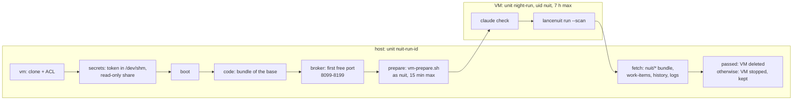
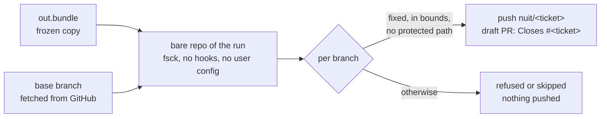

# Night VM — running lance-nuit in a confined Incus VM

An unattended run is given a project, a work item, and hours of autonomy. This
directory holds what keeps that run inside a box: a throwaway Incus VM with no
forge credential, a network ACL, and a broker that lends the VM a handful of
`gh issue` operations without ever lending it the token.

This file is the operating manual — **what to type**. The design notes, the
tickets, and the current state of the local VM fleet live outside the repository,
on the maintainer's machine.

## The pieces

| File | Role | Runs on |
|---|---|---|
| `provision-template.sh` | (re)installs `lancenuit`, updates Claude Code, pre-pulls Docker images, refreshes the `clean` snapshot | host |
| `harden.sh` | removes `gh`/`glab`/`acli`, installs the `gh` shim, denies the agents' web tools, refreshes `clean` | host |
| `network-acl.sh` | creates / applies / tests the `nuit` ACL | host |
| `night.sh` | runs one night end to end: VM, token, code, broker, preparation, run, fetch; `status`, `resume`, `clean` | host |
| `night_report.py` | settles a finished night and prints `night.sh status` | host |
| `vm-run.sh` | checks that Claude answers, then runs `lancenuit run --scan` as `nuit` | VM |
| `broker/gh-broker.py` | relays five `gh issue` shapes using the night's fine-grained token | host |
| `broker/gh-shim` | the fake `gh` installed in the VM; talks to the broker | VM |
| `publish-night-result.py` | turns the morning bundle into draft PRs, after checks | host |
| `incus-docker-forward.service` | restores IPv4 egress on both bridges, which Docker's `FORWARD DROP` breaks | host |

The reference template is a VM named `nuit-template` holding Debian 12, Docker,
Node 22, bun, the three agent CLIs, `lancenuit`, the Docker images of the pilot
project, and `nuit` (UID/GID 1001, member of `docker`), the unprivileged user
the agent runs as. Runs never use it directly: each run is a throwaway copy of
its `clean` snapshot. `/etc/nuit-template.json` inside it records what was
installed and when.

## Basic gestures

```sh
incus list                                    # what exists
incus start nuit-template
incus exec nuit-template -- bash              # root shell inside
incus stop nuit-template

incus snapshot list nuit-template
incus snapshot restore nuit-template clean    # back to the reference state
```

A VM takes about 15 s to answer after `start`. To wait for it properly:

```sh
for _ in $(seq 1 90); do incus exec <vm> -- true 2>/dev/null && break; sleep 1; done
```

## Making a run VM

```sh
incus copy nuit-template/clean nuit-run-01    # ~15 s
incus start nuit-run-01                       # ~14 s until Docker is ready
```

Destroy it afterwards — run clones are not kept:

```sh
incus delete nuit-run-01 --force
```

## One-time setup

To refresh the runner in an existing template, supply a verified tarball and
its source commit (see [package verification](../../CONTRIBUTING.md#package-readiness)):

```sh
./provision-template.sh --tarball /path/to/lance-nuit-0.1.0.tgz \
  --commit <git-sha> --sha256 <verified-sha256> \
  --image php:8.4-fpm --image mysql:8.0 ... \
  --compose-bundle /tmp/project.bundle --compose-ref main --compose-service php
```

The script checks the inputs before changing the VM, installs the latest Claude
Code CLI, creates the `nuit` user, and removes the system-wide `core.hooksPath`
that earlier templates set: the VM has no remote, so a `pre-push` guard
protected nothing and silenced the project's own hooks. It preserves the
previous `clean` snapshot under a dated name.

`nuit` runs the agent because Claude Code expects a non-root user for
`bypassPermissions`, and because Compose files commonly run their containers as
`${UID:-1001}`: files the stack writes in the project stay the agent's.
Membership of `docker` makes it root-equivalent inside the VM; the VM itself is
the boundary.

Each `--image` is pulled into the template, so a run VM finds it locally instead
of pulling it every night (minutes, and Docker Hub's anonymous rate limit). Pass
the base images of the project's Compose file, including the `FROM` and
`COPY --from` images of the Dockerfiles it builds:

```sh
docker compose -f <project>/docker-compose.yml config --images   # image: services
grep -h '^FROM\|--from=' <project>/docker/*/Dockerfile           # built services
```

`--compose-bundle` goes one step further for the services the project builds:
the bundle is cloned at `/srv/project`, where run VMs put the project, each
`--compose-service` is built there, then the clone is removed. The night still
runs `docker compose up --build`, which now hits the layer cache. The clone is a
fresh checkout, so no `vendor/` or `node_modules/` is baked into the template.

```sh
git -C <project> bundle create /tmp/project.bundle main
```

`harden.sh` writes the agents' settings under `/home/nuit`, so it runs after
`provision-template.sh`.

```sh
./harden.sh                    # hardening + gh shim + new 'clean' snapshot
./network-acl.sh create        # creates the 'nuit' ACL
```

Then, on every run VM:

```sh
./network-acl.sh apply nuit-run-01     # before `incus start`
./network-acl.sh test  nuit-run-01     # HTTPS passes; SSH and private addresses are blocked
```

`create` builds two things: the `nuit` ACL, and `nuitbr0`, the bridge that
carries it. On a bridge network — unlike OVN — `security.acls` is an option of
the *network*, not of the NIC, so an ACL on `incusbr0` would apply to every
instance on it, the template included and while it is being provisioned. Hence a
bridge of its own, with IPv6 off: a dual-stacked VM reaches AAAA-only routes
even when its IPv4 path is down, which hides exactly the kind of break this
setup must surface.

`apply` therefore moves the run VM's NIC onto `nuitbr0`. **Do it before the first
boot**: the VM's address changes with the bridge, and the gateway becomes
`10.174.226.1`.

The ACL filters on address, protocol and port, not on domain names: 80/443 stay
open to public addresses, DNS and the broker port range (8099-8199) are allowed
towards the gateway only, and everything else is refused. That already removes
outbound SSH, so `git@github.com:` is dead inside the VM.

Private ranges (`10/8`, `100.64/10`, `172.16/12`, `192.168/16`, `169.254/16`)
are refused on every port, web included: without that, the VM would reach the
LAN, the router, and the host's Docker containers through 80/443. Incus applies
`reject` rules before `allow` rules regardless of their order, so the gateway is
carved out of `10/8` and only its web ports are refused. `test` fails if the
host's router or the gateway answers on 80/443.

The broker rule is not optional: without it the shim cannot reach the host once
the VM is on the ACL'd bridge, and every `gh` call exits 127. Docker's
`FORWARD DROP` applies to the new bridge too, so
`incus-docker-forward.service` — which now covers both bridges — must be
reinstalled if it predates it.

## A night

```sh
./night.sh start --project ~/www/hypnose --pipeline claude   # returns at once
./night.sh status                                            # one line per night
./night.sh status <run-id>                                   # detail of one night
./night.sh resume <run-id> [--replay-interrupted]
./night.sh clean <run-id>                                    # deletes a kept VM
```

`start` refuses before anything is created when the base branch (`--base`,
otherwise `baseBranch` of `.lance-nuit/config.json`) lacks the pipeline or
`.lance-nuit/vm-prepare.sh`, differs from the same branch on `origin` (the
morning's PRs are based on GitHub's copy), when the Claude token is missing or
readable by others, or when the host `gh` is not authenticated. The repository
the broker serves is `workItem.project` unless `--repo` names it.

It then hands the night to a systemd user unit, `nuit-<run-id>`, held under
`systemd-inhibit --what=sleep`, and returns. Turn lingering on
(`loginctl enable-linger`), or logging out stops the night.



Every phase leaves a marker in `<run-dir>/phases/`. `resume` skips `vm` and
`code` when they are marked, and runs the rest again: after a reboot the token
is gone from `/dev/shm`, the VM is stopped and its containers with it, and
`vm-prepare.sh` is idempotent. `lancenuit` resumes its own runs. A step cut in
flight is refused on resume without `--replay-interrupted`, which `--scan`
rejects: with that option, the ticket the latest scan record left `running` is
replayed alone first, then the scan runs.

**The Claude token** is `~/.config/lance-nuit/claude-oauth-token`, made with
`claude setup-token`, mode `0600` (`NIGHT_TOKEN_FILE` overrides the path). Each
start copies it into `/dev/shm/nuit-<run-id>/`, shared read-only with the VM
before it boots. In the VM, systemd loads it as the run unit's credential and
`vm-run.sh` exports it as `CLAUDE_CODE_OAUTH_TOKEN`: it is never written to the
VM's disk. The host copy and the share are removed when the night ends,
whatever the outcome. The home of `nuit` holds no Claude configuration; the
pipeline's steps read the project's (`settingSources: "project"`).

**The Claude check.** Before the scan, `vm-run.sh` asks Claude (haiku) for one
word, with stdin closed: a token that does not authenticate, or a prompt for
onboarding or permissions, fails the night there, in seconds.

**What comes back**, in `~/.lance-nuit/night-runs/<run-id>/`, whatever ended the
night — success, failure, the 7-hour limit, or a stopped host unit:

| File | Content |
|---|---|
| `out.bundle` | the `nuit/<ticket>` branches above the base, verified against the project |
| `pipeline-history/`, `work-items/` | lance-nuit's scan records, run statistics and run directories |
| `worktree.patch`, `worktree.status` | uncommitted work left in the VM, if any |
| `night.log`, `prepare.log`, `run.log`, `gh-broker.log` | the unit, the preparation, the VM run, the broker's verdicts |
| `result.json` | `passed`, `failed` or `cut`, and why |

The archive from the VM is unpacked with Python's `data` filter and nothing in
it is executed. A night **passes** when the run exited 0, its last scan reached
its report, every ticket it touched is `fixed`, and the bundle verifies; an
empty queue passes too. Anything else keeps the VM, stopped, for inspection:
`night.sh clean` deletes it; run directories are never removed.

`status` reads the run directories: state, cost (root runs of
`pipeline-history/runs.jsonl`), branches of the bundle, and the VM if kept.

### The broker during a night

The broker carries the forge credential: a fine-grained GitHub token limited to
the project's repository with `Issues: Read and write`, in
`~/.config/lance-nuit/gh-broker-token`, mode `0600` (`NIGHT_GH_TOKEN_FILE`
overrides the path). `start` and `resume` refuse to run without it; the broker
gets it as `GH_TOKEN`, so the host's own `gh` login is never lent to the night.
The publisher, in the morning, still uses the host's login. The broker lives exactly as long as the
host unit: `night.sh` starts it and kills it when the night ends, however it
ends. It listens on the gateway, on the first free port of 8099-8199, recorded
in `<run-dir>/broker.port`. `--repo` is imposed at startup, so two nights on two
repositories never share one credential scope. The endpoint is written into the
VM at `/etc/lance-nuit/gh-broker.url`, which the shim reads (`GH_BROKER_URL`
overrides it, otherwise `http://10.174.226.1:8099/gh`).

Each night also generates a random broker credential, installed only in that VM
at `/etc/lance-nuit/gh-broker.token` with mode `0600`, owned by `nuit`. The broker requires it on
every request, so reaching another night's port does not grant access to its
repository. This credential is not a GitHub token. The host's temporary copy is
removed at the end; a resume rotates it. `GH_BROKER_TOKEN_FILE` overrides the shim's
credential path for local tests. Restarting with an older shim requires running
`harden.sh` or installing the updated shim first.

**Journal.** The `ALLOWED`/`REFUSED` verdicts go to `<run-dir>/gh-broker.log`;
`night.log` ends with their counts.

## Checking the `gh` shim from inside a VM

```sh
./test-broker-vm.sh
```

Self-contained: throwaway clone of the template, shim pushed into it, broker
started on the gateway, everything torn down at the end. It does not assume
`harden.sh` has run and does not touch the template. Read-only — nothing is
written to the repository.

What it proves, in order: the host `gh` is authenticated; the VM resolves its
endpoint from `/etc/lance-nuit/gh-broker.url` and reads real issues through the
shim; `gh auth token`, `gh api`, `gh repo clone`, another repository,
`issue delete` and `issue edit --body` are refused; no token-looking string is
left in the VM; and with the broker down the shim exits **127** with a clear
message — the code lance-nuit reads as "binary missing", so a clean failure
rather than a retry loop. That the broker dies with the night is covered by the
local tests below.

Options: `--repo owner/name` to target another repository, `--acl` to apply the
`nuit` ACL to the throwaway VM first — the only way to prove the ACL lets the VM
reach the broker — and `--keep` to keep the VM and dig around.

Each invocation uses a unique VM name and only deletes the clone it created.
The SSH check probes TCP port 22 without authenticating; DNS and probe errors
fail the test instead of counting as a blocked connection.

Local regression tests need Python 3 and Node.js, but no VM or GitHub access:

```sh
python3 -B -m unittest discover -s tools/night-vm -p 'test_*.py'
```

## What a project provides

`night.sh` knows nothing of the project's stack. The base branch carries:

- `.lance-nuit/vm-prepare.sh`, run as `nuit` in the project's clone before the
  agent: start the stack, install dependencies, create the test database.
  Idempotent, since a resume runs it again. A non-zero exit ends the night
  before any token is spent.
- the pipeline, whose first step puts each ticket on `nuit/<ticket>`: only those
  branches come back, and the publisher refuses any other ref. Its steps never
  push.
- the project's agent context (`CLAUDE.md`, `.claude/skills/`), versioned: the
  VM receives the base branch and the token, nothing else.

The code travels as a bundle of the base branch rather than a copy of the
clone: a copy carries the GitHub remote with it, which is exactly what the
confinement forbids. The bundle is verified in a throwaway repository before
the clone, and the clone loses its `origin`.

## Publishing in the morning

What comes back from the VM is untrusted: a branch can add a GitHub workflow
that runs on push, or a hook, a `.claude/` setting or a `.envrc` that runs on a
later checkout. So the bundle is never fetched into a working clone, and only
the host, holding the forge credential, publishes.

```sh
./publish-night-result.py <run-id> --repo owner/name --dry-run   # checks only
./publish-night-result.py <run-id> --repo owner/name             # push + draft PRs
```

It reads `~/.lance-nuit/night-runs/<run-id>/`: `out.bundle`, holding the
`nuit/<ticket>` branches above the base branch (`--base`, `main` by default),
and `pipeline-history/scans/*.json`, the scan records of the run.



The whole run is refused, before any push, when the bundle is a link, exceeds
`--max-bundle-bytes` (20 MiB), carries a ref other than `refs/heads/nuit/<n>`,
does not apply to the base branch as it is on GitHub, or holds objects
`git fsck --strict` rejects. Then each branch is checked on its own:

| Check | Outcome when it fails |
|---|---|
| its ticket is `done` with outcome `fixed` in a scan record of `--repo` | skipped |
| it shares history with the base branch and adds 1 to `--max-commits` (50) commits, none a merge | refused |
| no commit touches a protected path (below), no submodule | refused |
| at most `--max-files` (200) files and `--max-lines` (20000) changed lines | refused |
| `nuit/<ticket>` is absent on GitHub or already at the same commit | refused |

Protected paths, compared case-insensitively: `.github/`, `.gitmodules`,
`.lance-nuit/`, `.claude/`, `.codex/`, `.opencode/`, `.mcp.json`, `CLAUDE.md`,
`CLAUDE.local.md` and `AGENTS.md` at any depth, hook managers (`.husky/`,
`.githooks/`, `.git-hooks/`, `lefthook*.yml`, `.pre-commit-config.yaml`), and
what an editor or shell runs on its own (`.vscode/`, `.idea/`, `.envrc`). Every
commit is checked, not only the final diff: a workflow added and then removed
still refuses the branch. A refused branch is never pushed, since pushing
alone triggers workflows; read it without checking it out:

```sh
git -C ~/.lance-nuit/night-runs/<run-id>/publish/repo.git show --stat refs/night/<ticket>
```

An accepted branch is pushed without force, then opened as a draft PR whose
title is the issue's and whose body closes it and lists the commits and files.
The PR is where the code gets reviewed. Running the command again is safe: a
branch already at the same commit is not pushed again, an existing PR is not
duplicated, and a PR whose creation failed after the push is created.

Git runs with the user and system configuration ignored, hooks disabled, and
`gh auth git-credential` as the only credential helper, so `GH_TOKEN`, if set,
is the credential used for both the push and the PR. Each verdict is appended
to `<run-dir>/publish.jsonl` with the run, ticket, commit, ref and PR URL. The
exit status is 0 when nothing was refused or failed.

The base branch must be on GitHub as the VM saw it: a run started from a local
`main` with unpushed commits is refused, because the PR could not be based on it.

## Troubleshooting

**No IPv4 egress in the VM** (pinging the gateway works, `curl` times out).
Docker sets `FORWARD DROP` on the host and drops `incusbr0` traffic.

```sh
systemctl is-active incus-docker-forward.service   # must say 'active'
sudo systemctl restart incus-docker-forward.service
```

Trap: a `docker pull` **still succeeds** in that state, because Docker Hub has
AAAA records — it falls back to IPv6 and proves nothing. Test with
`curl -4 https://github.com`, which has none.

**`incus` answers "permission denied"**: membership of the `incus-admin` group
only takes effect in the next session. Otherwise `sudo incus`.

**"QEMU command not available"**: `sudo systemctl restart incus` after installing
QEMU.

**The `gh` shim answers "broker unreachable"**: the broker is not running on the
host, the ACL blocks the port, or the VM points at the wrong port. Check, in that
order, `cat /etc/lance-nuit/gh-broker.url` inside the VM and
`<run-dir>/broker.port`. The shim exits 127, which lance-nuit reads as "binary
missing".

**`docker: unknown command: docker compose` as `nuit`**: the CLI fails on a
plugin directory it cannot read, such as a `/usr/local/libexec` that
`incus file push --create-dirs` created with mode `0750`. Make it `0755`.
